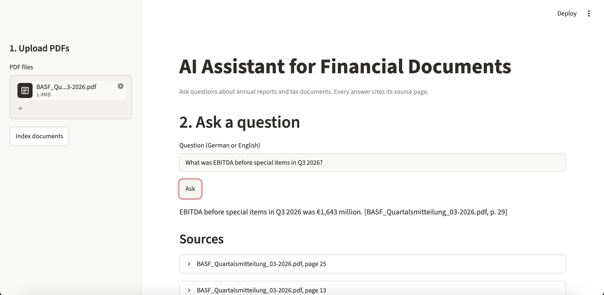
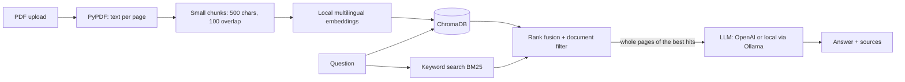

# AI Assistant for Financial Documents

Ask questions about annual reports, quarterly statements and tax documents in **German or English**.
Every answer cites the **source file and page**, so it can be checked. If the answer is not in the documents, the assistant says so instead of guessing.



## Problem
Consultants and finance or tax teams spend a lot of time searching long PDF reports for specific figures.
General chatbots don't know these documents and can invent numbers, which is unacceptable in finance.

## Solution
**Retrieval-Augmented Generation (RAG):** documents are split into chunks and indexed in a local vector database.
For each question, the most relevant chunks are retrieved, and the LLM answers **only from them**, with page citations.

## Architecture


| File | Purpose |
| --- | --- |
| `ingest.py` | PDF → pages → small chunks → embeddings → ChromaDB; saves full page texts |
| `rag.py` | Hybrid search (embeddings + BM25), document filter, whole-page context, LangChain chain with a citation prompt |
| `api.py` | REST API with FastAPI: `/upload`, `/ask` (optional `document`), `/documents`, `/health` |
| `app.py` | Streamlit UI for the demo: upload, "Search in" document selector, answers with sources |
| `evaluate.py` | Validation: accuracy with 95% CI, retrieval hit rate, hallucination rate; in-sample vs. out-of-sample |
| `config.py` | All settings in one place |

## Tech stack
Python, LangChain, ChromaDB, sentence-transformers, OpenAI API (switchable to Ollama), FastAPI, Streamlit, pandas

## Evaluation
The system is validated like a model: fixed questions with known answers, every expected answer
checked against the PDF text, and an **out-of-sample test on reports never used for tuning**.

| Set | Documents | Questions | Role |
| --- | --- | --- | --- |
| In-sample | BASF Q3 2026 (German) | 10 | first tuning |
| Out-of-sample | Bayer Q3 2026 (German), Evonik Q3 2026 (English) | 72 + 7 traps | used to diagnose and fix errors |
| **Hold-out** | **Henkel Q3 2026 (English)** | **34 + 4 traps** | **tested once, at the very end** |

Trap questions ask for something that is in no document; the correct answer is "not found".

### From overfitting to generalisation (`TOP_K = 8`)

| Version | BASF (in-sample) | Bayer + Evonik | Henkel (hold-out) | Confident wrong answers |
| --- | --- | --- | --- | --- |
| Baseline (one index, 1,000-char chunks) | 80% | 57% | – | 0% |
| + document filter | 90% | 85% | – | 4% |
| + table hint in the prompt | 90% | 83% (no gain, removed) | – | 4% |
| + small-to-big (search small chunks, answer with whole pages) | 100% | 85% | – | 3% |
| **+ hybrid search (embeddings + BM25)** | **90%** | **96%** [88–99%] | **100%** [90–100%] | **0%** |

95% Wilson confidence intervals in brackets.

**What the diagnosis showed**
- **Overfitting was real:** the first score (91% on BASF) dropped to 57% on new reports.
- **The search was the bottleneck, not the LLM.** For every question the evaluation checks whether the page with the answer reached the LLM. Most failures were retrieval misses, and the prompt fix changed nothing.
- **Reports competed with each other** → document filter (+28 points).
- **The embedding model reads only 128 tokens (~500 characters)**, so half of each 1,000-character chunk was never searchable → small chunks for search, whole pages (with table headings) for the answer.
- **Meaning-based search misses exact table terms** ("Konzernumsatz", "Beschäftigte") → added BM25 keyword search and merged both rankings with Reciprocal Rank Fusion.

Run it yourself:
```bash
python evaluate.py 8 --filter                                          # Bayer, Evonik, BASF
python evaluate.py 8 --filter --questions=eval/holdout_questions.csv   # Henkel hold-out
```

## Setup
```bash
python3 -m venv .venv && source .venv/bin/activate
pip install -r requirements.txt
cp .env.example .env          # add your OpenAI API key
uvicorn api:app --reload      # terminal 1: API on http://localhost:8000/docs
streamlit run app.py          # terminal 2: UI on http://localhost:8501
```
On macOS you can also double-click `start.command`, which starts both. Upload PDFs in the UI sidebar
(or run `python ingest.py path/to/report.pdf`).

## Data privacy
Embeddings are computed **locally**; only the few retrieved chunks are sent to the LLM.
With `LLM_PROVIDER=ollama` in `.env`, the whole pipeline runs locally and no document leaves the machine,
which matters for confidential client data.

## Limitations
- Tables lose their row/column structure when converted to text; whole-page context reduces, but does not remove, column mix-ups.
- The test set is still small (89 + 38 questions on four reports), and questions written from the report text tend to be easier than real user questions.
- Scanned PDFs (images only) need OCR, which is not included yet.
- Cited page numbers are PDF page numbers, which can differ from the printed page numbers.
- Answers should still be reviewed by a human before use.

## Next steps
- Larger hold-out set with more complex reports (the Henkel statement contains mainly sales figures)
- Table-aware PDF parsing, so table columns are not lost when PDFs are converted to text
- A reranker or a stronger multilingual embedding model
- OCR for scanned documents, Docker for easy deployment
