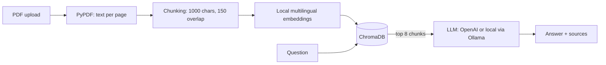

# AI Assistant for Financial Documents

Ask questions about annual reports, quarterly statements and tax documents in **German or English**.
Every answer cites the **source file and page**, so it can be checked. If the answer is not in the documents, the assistant says so instead of guessing.


## Problem
Consultants and finance or tax teams spend a lot of time searching long PDF reports for specific figures.
General chatbots don't know these documents and can invent numbers, which is unacceptable in finance.

## Solution
**Retrieval-Augmented Generation (RAG):** documents are split into chunks and indexed in a local vector database.
For each question, the most relevant chunks are retrieved, and the LLM answers **only from them**, with page citations.

## Architecture


| File | Purpose |
| --- | --- |
| `ingest.py` | PDF → pages → chunks → embeddings → ChromaDB |
| `rag.py` | Retrieval + LangChain chain with a citation prompt |
| `api.py` | REST API with FastAPI: `/upload`, `/ask`, `/health` |
| `app.py` | Streamlit UI for the demo (calls the API) |
| `evaluate.py` | Accuracy test on questions with known answers |
| `config.py` | All settings in one place |

## Tech stack
Python, LangChain, ChromaDB, sentence-transformers, OpenAI API (switchable to Ollama), FastAPI, Streamlit, pandas

## Evaluation
Tested on a real document: the **BASF quarterly statement Q3 2026** (German, 33 pages), with 11 questions
(10 key figures in German and English, plus 1 question whose answer is not in the document).

| Retrieved chunks (`TOP_K`) | Accuracy |
| --- | --- |
| 4 | 7/11 (64%) |
| 8 | **10/11 (91%)** |

**Findings**
- Financial reports report the same metric for the group and for each segment. With only 4 chunks, the model once returned a segment's EBITDA instead of the group figure. With 8 chunks, it found the correct value.
- The remaining error is a retrieval miss on a table row (number of employees). The assistant answered that it could not find the figure **instead of inventing one**, which is the safe failure mode for finance.

Run it yourself: `python evaluate.py`

## Setup
```bash
python3 -m venv .venv && source .venv/bin/activate
pip install -r requirements.txt
cp .env.example .env          # add your OpenAI API key
uvicorn api:app --reload      # terminal 1: API on http://localhost:8000/docs
streamlit run app.py          # terminal 2: UI on http://localhost:8501
```

## Data privacy
Embeddings are computed **locally**; only the few retrieved chunks are sent to the LLM.
With `LLM_PROVIDER=ollama` in `.env`, the whole pipeline runs locally and no document leaves the machine,
which matters for confidential client data.

## Limitations
- Tables lose their row/column structure when converted to text, so table values are harder to retrieve.
- Scanned PDFs (images only) need OCR, which is not included yet.
- Cited page numbers are PDF page numbers, which can differ from the printed page numbers.
- Answers should still be reviewed by a human before use.

## Next steps
- **Hybrid search** (semantic + keyword search) to find exact terms in tables more reliably
- Filter questions by document (e.g. only the 2026 report)
- Table-aware PDF parsing and OCR for scanned documents
- Key-figure extraction to Excel
- Larger evaluation set; Docker for easy deployment